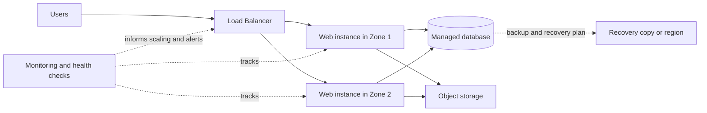

# Azure Zero to Hero - Day 1: Cloud Computing Fundamentals

## Topic Index

1. [Why cloud fundamentals matter](#why-cloud-fundamentals-matter)
2. [Servers and data centers](#servers-and-data-centers)
3. [Private, public, hybrid, and multicloud](#private-public-hybrid-and-multicloud)
4. [Cloud computing](#cloud-computing)
5. [Virtualization and virtual machines](#virtualization-and-virtual-machines)
6. [APIs](#apis)
7. [Azure regions and availability zones](#azure-regions-and-availability-zones)
8. [Load balancing](#load-balancing)
9. [Scalability and elasticity](#scalability-and-elasticity)
10. [Agility, high availability, and disaster recovery](#agility-high-availability-and-disaster-recovery)
11. [Putting the concepts together](#putting-the-concepts-together)
12. [Interview quick review](#interview-quick-review)

---

## Why Cloud Fundamentals Matter

Cloud platforms such as Azure, AWS, and Google Cloud use many of the same foundational ideas. Their services and terminology differ, but concepts such as servers, virtualization, regions, scaling, and APIs apply across providers.

Understanding these basics makes it easier to learn Azure services and follow technical documentation. This lesson introduces the vocabulary; later lessons can explore the implementation details in Azure.

## Servers and Data Centers

A **server** is a computer that provides resources or services to other computers. Like a personal computer, it has processing power (CPU), memory (RAM), storage, and an operating system. Servers are designed to run applications and processes reliably, often for many users at once.

A **data center** is a facility containing many servers and the supporting infrastructure needed to operate them, such as networking equipment, power systems, cooling, and physical security.

Before public cloud platforms became common, organizations often bought and operated their own servers. This gave them control, but also required them to provision hardware, maintain facilities, apply updates, plan capacity, and handle failures.

### Practical example

A retailer running its own online store might buy servers, install them in a data center, connect them to the network, and assign administrators to maintain them. If demand grows, the retailer must obtain and configure more hardware.

## Private, Public, Hybrid, and Multicloud

### Private cloud

A **private cloud** is cloud infrastructure dedicated to one organization. It may run in the organization’s own data center or be hosted by a provider. The organization has more control over the environment, but may also take on more management responsibility.

**Example:** A financial organization keeps a regulated workload in an environment dedicated to that organization because its security, compliance, or legacy requirements call for greater control.

### Public cloud

A **public cloud** is infrastructure and services offered by a cloud provider to many customers. Customers provision resources as needed rather than purchasing and maintaining the underlying data-center hardware themselves.

**Example:** A startup creates virtual machines and a managed database in Azure and pays for the resources it uses, instead of building a physical data center.

### Hybrid cloud

A **hybrid cloud** combines private infrastructure with public-cloud services, with connectivity or integration between them.

**Example:** A company hosts its customer-facing web application in Azure but keeps a sensitive legacy database in its own data center. The application securely connects to that database.

### Multicloud

**Multicloud** means using services from more than one public cloud provider.

**Example:** A company runs its primary application in Azure and uses a service from another cloud provider for a separate workload.

**Do not confuse the terms:** Hybrid describes a combination of private/on-premises and public cloud environments. Multicloud describes using multiple cloud providers. A company can use both approaches.

## Cloud Computing

**Cloud computing** is the delivery and use of computing resources and services over a network, commonly the internet. Instead of owning every server and data-center component, an organization can provision services from a cloud provider and manage them through a portal, command-line tool, or API.

Cloud computing can include virtual machines, networking, databases, storage, application hosting, monitoring, and many other managed services. The customer and provider share operational responsibilities; the exact split depends on the service being used.

## Virtualization and Virtual Machines

**Virtualization** allows one physical server to run multiple logically isolated computing environments. A software layer called a **hypervisor** allocates the physical server's CPU, memory, storage, and networking to these environments.

A **virtual machine (VM)** is one such environment. It behaves like a computer with its own operating system and allocated resources, while sharing underlying physical hardware with other VMs.

### Practical example

Suppose a physical server has enough capacity for several workloads. A hypervisor can allocate a portion of its resources to a VM for a web server and another portion to a VM for a test environment. A cloud customer can request a VM without needing to know which physical server hosts it.

In public cloud, the provider manages the physical infrastructure and virtualization platform. The customer selects a VM configuration and manages the parts of the VM included in the service agreement, such as its operating system and application.

## APIs

An **API (Application Programming Interface)** is a defined way for one software system to interact with another. A cloud provider exposes APIs so applications, scripts, command-line tools, and portals can request or manage cloud resources.

A portal is a visual interface for making requests. A script can make equivalent requests programmatically, which is useful for repeatable automation and large-scale operations.

### Practical example

An engineer could create one VM through the Azure portal. To create many similar VMs consistently, a script or infrastructure-as-code tool can send requests through Azure's management APIs.

```text
Portal or automation script
             |
             v
      Azure management API
             |
             v
 Create or configure Azure resource
```

## Azure Regions and Availability Zones

An **Azure region** is a geographical area that contains one or more Azure data centers. Organizations choose regions based on factors such as latency, service availability, data-residency requirements, and resilience design.

**Availability zones** are physically separate locations within a supported Azure region. Each zone has independent infrastructure, including power, cooling, and networking. A region may support multiple zones, but zone availability and service support vary by region.

Using multiple zones can help keep an application available if one zone has an outage. A zone-based design still needs application-level configuration, data replication, and appropriate failover behavior; simply selecting a region does not automatically make an application highly available.

### Practical example

A ticket-booking service deploys application instances across two availability zones in a region. If one zone becomes unavailable, a load balancer can direct traffic to healthy instances in the other zone, provided the application and its data layer are designed to support that failover.

## Load Balancing

A **load balancer** distributes incoming network traffic across multiple healthy application instances. This helps avoid sending every request to one server and can improve availability when an instance becomes unhealthy.

A load balancer commonly uses health probes to determine whether an instance should receive traffic. It does not, by itself, create more application capacity; scaling out requires adding instances as well.

### Practical example

An online store runs three web-server instances. A load balancer distributes customer requests among them. If one instance fails its health check, traffic can be directed to the remaining healthy instances.

## Scalability and Elasticity

**Scalability** is the ability of a system to handle increased or decreased demand by changing its available capacity.

Two common approaches are:

- **Scale up/down (vertical scaling):** increase or decrease the resources of an existing machine, such as CPU or memory.
- **Scale out/in (horizontal scaling):** add or remove application instances.

Scaling can be manual or automated. Automated scaling rules can use signals such as CPU utilization, request count, or schedules, within configured limits.

**Elasticity** describes how capacity can adjust dynamically as demand changes, especially when resources can scale out or in automatically. Elasticity is related to scalability but emphasizes adapting to changing demand.

### Practical example

A sports-streaming service sees a large increase in viewers during a live final. It adds web instances and distributes traffic across them. After the event, it removes the extra instances to reduce unused capacity and cost.

## Agility, High Availability, and Disaster Recovery

### Agility

**Agility** is the ability to provision, change, or release resources quickly. Cloud self-service and automation can help teams test ideas and deliver changes faster than waiting to procure and install physical hardware.

**Example:** A development team provisions a temporary test environment for a release and removes it after testing.

### High availability

**High availability (HA)** is a design goal of keeping a service accessible for a high proportion of time. It is supported by removing single points of failure, deploying redundant components, monitoring health, and using failover mechanisms.

**Example:** An application has instances in separate availability zones and a load balancer routes traffic to healthy instances.

### Disaster recovery

**Disaster recovery (DR)** is the plan and capability for restoring a service after a major outage or disaster. It can include backups, replicated data, recovery environments, documented procedures, and tested failover processes.

**Example:** A business backs up its database and maintains a recovery plan to restore or fail over to another region if the primary region has a major outage.

HA and DR address different failure scopes: HA helps keep a service running through component failures; DR focuses on recovering from larger disruptions. Both require deliberate architecture, configuration, and testing.

## Putting the Concepts Together

A simplified cloud application design might look like this:



This diagram combines several ideas:

- Users access an application through a load balancer.
- Application instances run in separate zones for resilience.
- The application uses a database and object storage for different data needs.
- Monitoring supports alerting and scaling decisions.
- Backups or replication support disaster recovery.

This is a conceptual example, not a complete production architecture. A real design must also account for identity, network security, secrets, data consistency, cost, and recovery objectives.

## Interview Quick Review

### What is the difference between a server and a data center?

A server is a computer that runs applications or provides services. A data center is a facility containing many servers and the supporting infrastructure to operate them.

### What is the difference between public and private cloud?

Public cloud services are provided by a cloud provider to many customers. A private cloud is dedicated to one organization, whether hosted on-premises or by a provider.

### What is the difference between hybrid cloud and multicloud?

Hybrid cloud combines private/on-premises infrastructure with public cloud. Multicloud uses services from multiple public-cloud providers.

### What is a virtual machine?

A VM is a software-defined computer with allocated compute, memory, storage, and an operating system, running on shared physical infrastructure through virtualization.

### What is an API in cloud computing?

It is a programmatic interface for requesting or managing cloud services. Scripts and tools use APIs to automate operations that could also be performed through a portal.

### What is the difference between a region and an availability zone?

A region is a geographical area containing Azure data centers. Availability zones are physically separate locations within a supported region, designed to provide isolation from some local failures.

### What is the difference between scalability and elasticity?

Scalability is the ability to change capacity to meet demand. Elasticity emphasizes dynamically adjusting capacity as demand changes.

### What is the difference between high availability and disaster recovery?

High availability aims to keep a service running through component failures. Disaster recovery is the plan to restore service after a major disruption.

## Key Takeaways

- Cloud providers deliver computing resources and services over a network.
- Data centers contain the physical infrastructure; virtualization divides server capacity into isolated VMs.
- APIs allow resources to be managed programmatically and repeatedly.
- Regions and availability zones support geographic placement and resilience planning.
- Load balancers distribute traffic across healthy instances; scaling changes the amount of capacity.
- High availability and disaster recovery require design and testing; they are not automatic guarantees.
- Private, public, hybrid, and multicloud describe different ways organizations use cloud infrastructure.
