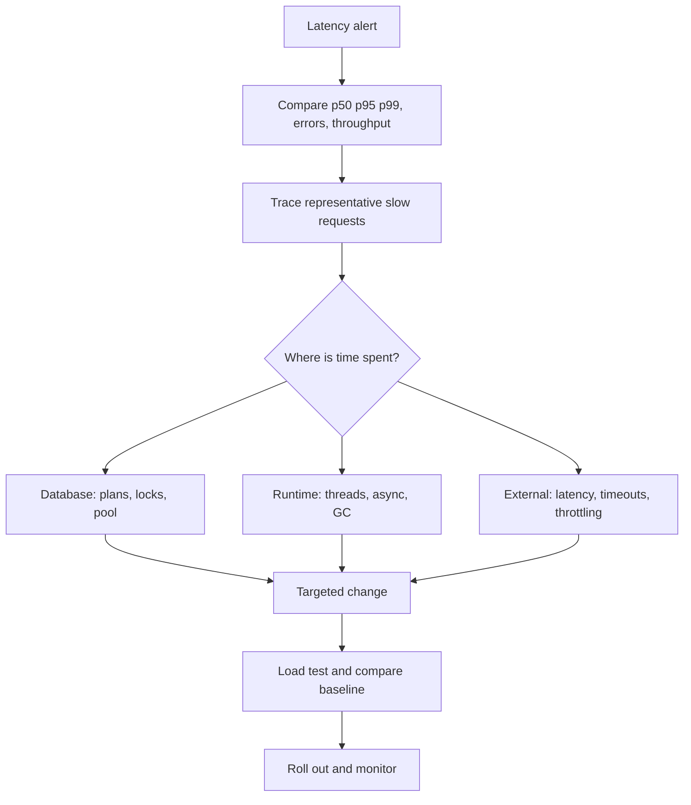
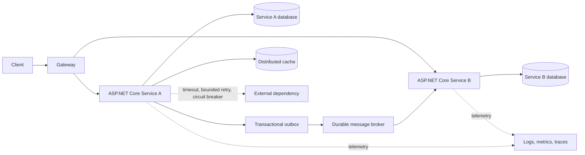
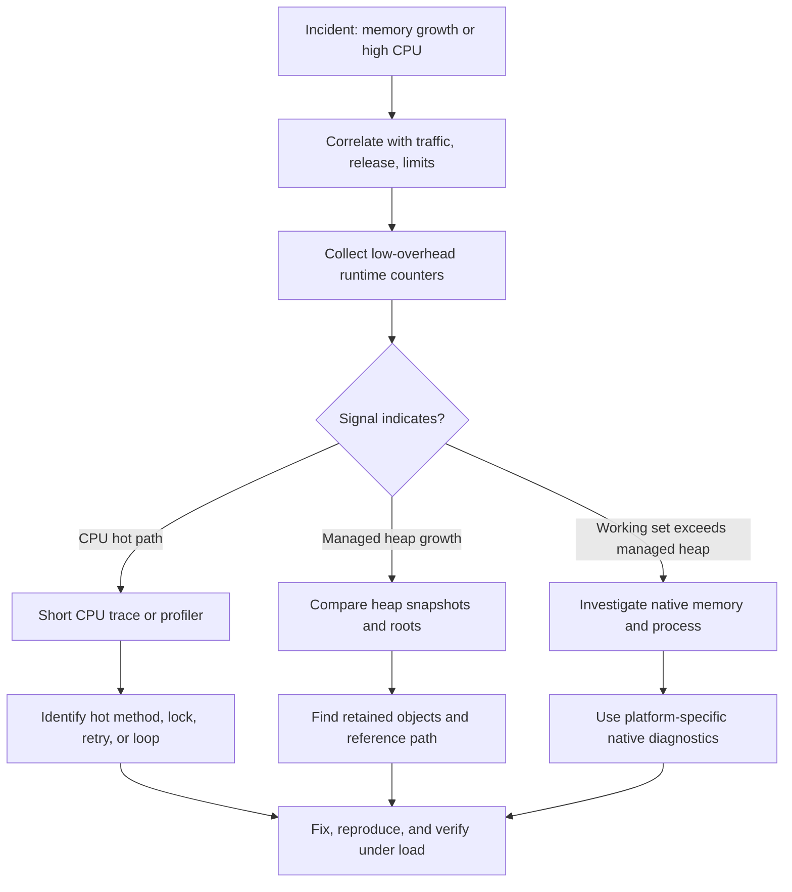
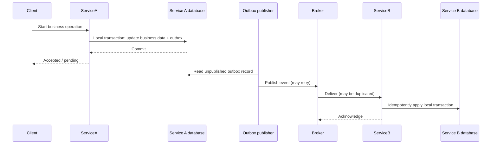
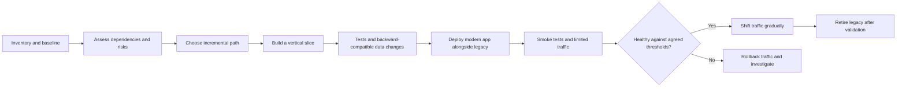
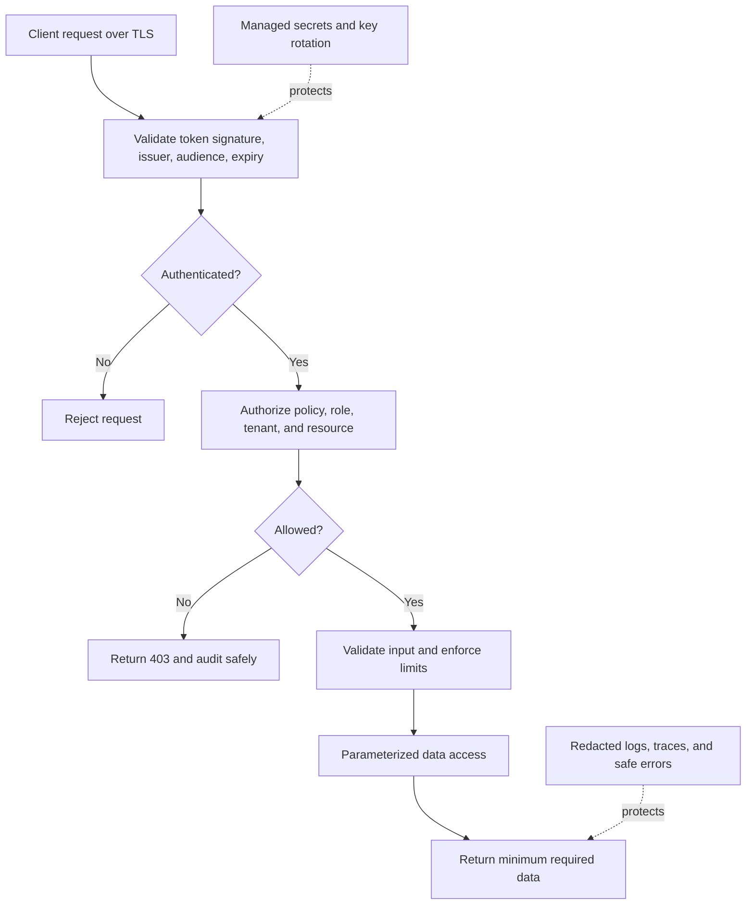
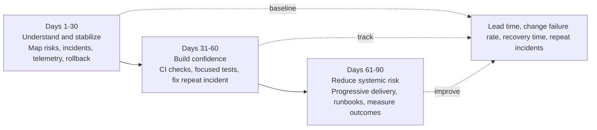

# .NET Production Architecture, Reliability & Modernization Interview Q&A

Use these as interview-ready answer frameworks rather than scripts. Tailor the examples, tools, hosting platform, and results to your actual experience. Be specific about what you personally measured or changed, and do not claim production outcomes you cannot substantiate.

## 1. Your .NET API experiences a sudden increase in latency under heavy traffic. How would you identify bottlenecks?

**Sample answer:**

"I would first establish the scope and timeline of the latency increase. I would compare p50, p95, and p99 latency, throughput, error rate, and saturation against the normal baseline, then break the data down by endpoint, dependency, region, and deployment version. I would use a trace or correlation ID to follow representative slow requests end to end. This helps distinguish a general capacity problem from a specific endpoint, query, or downstream service."

"Next I would check each resource boundary rather than assume the database is at fault:

1. **Database:** Use distributed traces and database telemetry to identify slow or frequent queries. Inspect query plans, logical reads, index usage, lock waits, connection-pool usage, and database CPU. Check for N+1 queries, unbounded result sets, missing pagination, inefficient predicates, and long transactions. Optimize the query or data access pattern based on evidence.
2. **Threading and async work:** Look at request queue length, thread-pool thread count, thread-pool queue length, CPU, and time spent waiting. Check for sync-over-async (`.Result` or `.Wait()`), blocking locks, excessive parallel work, and thread-pool starvation. Ensure I/O-bound work uses asynchronous APIs end to end, and bound concurrency where fan-out could overwhelm a dependency.
3. **Memory and garbage collection:** Track allocation rate, managed heap size, Gen 2 and large-object-heap collections, GC pause time, and working set. High allocation rates can cause frequent collections even when there is no leak. Use a memory profiler or a carefully captured dump to find allocation hot spots, retained object graphs, unbounded caches, and undisposed resources.
4. **External dependencies:** Use traces and dependency metrics to compare latency, timeouts, throttling, and failures for each downstream service. Verify connection reuse, configured timeouts, DNS/network behavior, and retry volume. Retries can multiply load during an incident, so I would check whether they are bounded and use backoff."

"Useful tools include OpenTelemetry traces and metrics, Application Insights or another APM system, `dotnet-counters` for live runtime metrics, `dotnet-trace` for event traces, and `dotnet-dump` or a profiler for dump analysis. I would correlate these with database-native query and wait statistics. I would avoid collecting heavy traces or dumps indiscriminately in production; I would use a controlled window, sampling, and the platform's safe diagnostic procedures."

"Once the dominant bottleneck is identified, I would make one targeted change, load-test it against a representative workload, and compare the same latency percentiles, throughput, and error rates. If the service is overloaded, I would also mitigate safely—such as limiting concurrency, shedding nonessential work, or scaling where that addresses the measured bottleneck—while investigating the root cause."

**Key point:** Diagnose by following a slow request and measuring each constrained resource. Do not treat scaling out as a substitute for fixing a saturated database, blocked thread pool, or failing dependency.

## 2. How would you design a scalable, resilient microservices architecture using ASP.NET Core, asynchronous messaging, and distributed caching?

**Sample answer:**

"I would start with business capabilities and clear service ownership, not split the application into services solely by technical layer. Each service would own its domain logic and data boundary, expose a versioned API for synchronous queries or commands that need an immediate response, and publish or consume messages for work that can happen asynchronously. ASP.NET Core services would be stateless where practical, so instances can scale horizontally behind a gateway or load balancer."

"For messaging, I would use a durable broker with explicit message contracts, schema/versioning rules, and dead-letter handling. Consumers should be idempotent because brokers commonly provide at-least-once delivery: a message can be delivered again. I would use bounded consumer concurrency, retry transient errors with backoff, and route poison messages to a dead-letter queue for investigation rather than retry them forever. If a database update and message publication must stay consistent, I would use the transactional outbox pattern rather than commit one and hope the other succeeds."

"For distributed caching, I would cache data that is read frequently and can tolerate a defined amount of staleness. I would set expiration and size limits, define invalidation or refresh behavior, and include the right tenant or authorization scope in cache keys. I would not use a cache as the source of truth or assume a cache hit is always available. To avoid a cache stampede, I would consider request coalescing, jittered expiration, or controlled refresh. If the cache is unavailable, the fallback must be bounded so that every request does not overwhelm the database."

"To prevent cascading failures, I would set timeouts and cancellation propagation on every network call, limit concurrency and queues, and use circuit breakers or load shedding when a dependency is persistently unhealthy. I would retry only transient failures, only a small bounded number of times, and only when the operation is safe to retry. I would avoid stacking retries at multiple layers. Health checks should distinguish process liveness from readiness to receive traffic, and telemetry should include service, dependency, queue, and end-to-end latency and error rates."

"Finally, I would deploy incrementally with health-based rollout and rollback, keep APIs and messages backward-compatible during version transitions, and test failure scenarios such as broker outages, duplicate messages, slow dependencies, and cache loss. Microservices add operational and consistency costs, so I would keep a modular monolith if independent deployment or scaling is not a real requirement."

**Design points to emphasize:**

- Service boundaries based on business capabilities and data ownership.
- Durable messaging with idempotent consumers and dead-letter handling.
- Outbox for reliable state-change publication.
- Cache-aside or another explicit cache strategy with bounded fallback.
- Timeouts, bounded retries, circuit breakers, concurrency limits, and observability.
- Operational complexity is a tradeoff, not a reason to choose microservices by default.

## 3. A production application has intermittent memory leaks and high CPU utilization. Which tools and profiling techniques would you use?

**Sample answer:**

"I would first determine whether memory is actually growing without being released, or whether the service has a high but stable working set, a temporary traffic-driven increase, or high allocation churn. I would compare memory and CPU with request volume, deployment versions, GC metrics, and the timing of the incidents. I would also check container or process limits, because hitting a memory limit can cause restarts even when the managed heap does not look unusually large."

"For a live .NET process, I would start with low-overhead counters using `dotnet-counters` or the hosting platform's runtime metrics. I would examine allocation rate, GC heap size, Gen 2 collections, time in GC, working set, CPU, thread-pool queue length, and exception rate. For CPU, I would capture a short `dotnet-trace` or profiler recording during a representative spike and identify hot methods, excessive serialization or logging, tight loops, lock contention, and unexpected retry or polling activity."

"For memory, I would compare snapshots taken at meaningful points, such as after a warm-up and after sustained representative load. A `dotnet-gcdump` can help inspect managed heap composition; a process dump analyzed with `dotnet-dump` or a memory profiler can show object counts, roots, and retaining paths. I would look for static references, event-handler subscriptions, unbounded collections or caches, long-lived tasks, buffers, large object heap pressure, and native or unmanaged allocations. A managed heap snapshot alone may not explain native memory growth, so I would compare it with process working set and use platform-specific native diagnostics if needed."

"I would reproduce the issue under a controlled load test where possible, use sampling and short captures to limit production overhead, and compare before and after a suspected fix. For a suspected leak, I would verify that retained objects continue to grow after the workload returns to normal and that the retaining reference is understood. For high CPU, I would use a CPU profile rather than infer hot paths from logs. I would also review recent deployments and configuration changes to narrow the regression window."

"After fixing the root cause, I would add a regression test or load-test assertion where practical, and add alerts for the relevant leading indicators—for example, sustained heap growth, allocation rate, CPU saturation, GC pause time, or repeated container restarts."

**Tools to name, as applicable:** `dotnet-counters`, `dotnet-trace`, `dotnet-dump`, `dotnet-gcdump`, Visual Studio Profiler, PerfView, JetBrains dotMemory/dotTrace, and the hosting platform's container and process metrics.

## 4. How would you manage database transactions and consistency across multiple services without distributed transactions?

**Sample answer:**

"I would avoid a distributed transaction across independently owned services. Instead, each service would make a local atomic transaction against its own database and coordinate a business process through messages. The overall workflow is usually eventually consistent, so I would make the intermediate states and recovery behavior explicit."

"For publishing an event after a local database update, I would use the **transactional outbox**. The service writes both the business change and an outbox record in one local transaction. A background publisher sends the outbox event to the broker and marks it as published. Since publication or delivery can be repeated, consumers use an inbox, deduplication key, or idempotent operation to avoid applying the same business effect twice."

"For a multi-step business process, I would model a **saga**. A choreography-based saga lets services react to events; an orchestration-based saga uses a coordinator to track the process and issue commands. I would choose based on workflow complexity and ownership, not preference alone. Each step should have a defined timeout, retry policy, observable state, and—where needed—a compensating action. Compensation is a new business operation, not a magical rollback, so I would define what happens if compensation also fails and provide a repair or manual-review path."

"I would use stable correlation and idempotency identifiers, explicit workflow states, and reconciliation jobs to detect stuck or inconsistent processes. APIs should communicate whether an operation is accepted, pending, completed, or failed rather than imply that all downstream work completed synchronously. The user experience and business rules must tolerate eventual consistency; if a particular invariant truly must be immediate, I would keep that decision within one service and one local transaction where possible."

**Key tradeoff:** Eventual consistency improves service autonomy and availability but requires explicit state transitions, duplicate handling, reconciliation, and clear user-facing behavior.

## 5. A legacy .NET Framework application must be migrated to modern .NET with minimal downtime. How would you plan and manage the migration?

**Sample answer:**

"I would treat this as a risk-managed modernization, not a one-shot rewrite. First I would inventory the application: project types and target framework, hosting model, NuGet and third-party dependencies, Windows-only APIs, authentication, database access, scheduled jobs, integrations, deployment process, traffic patterns, and operational requirements. I would establish baseline behavior and performance, identify unsupported or high-risk dependencies, and agree on rollback criteria and an acceptable downtime window."

"Next I would select a migration path based on the application's shape. A simple, well-tested service may be suitable for an in-place framework and dependency upgrade. A large application with separable features may be safer to migrate incrementally using the strangler pattern: route a small capability to a modern .NET service, observe it, and gradually move more behavior. I would use compatibility tooling such as the .NET Upgrade Assistant where appropriate, but validate the result rather than treating automated changes as complete."

"I would create a vertical slice early—build, deploy, authenticate, access required data, emit telemetry, and roll back in a non-production environment—so infrastructure and dependency risks surface before broad code changes. I would replace or isolate incompatible dependencies, upgrade packages in controlled steps, and add characterization and contract tests around important existing behavior. Database changes should be backward-compatible during the transition: use expand-and-contract changes, support old and new application versions concurrently, and avoid destructive schema changes until the old version is retired."

"For a low-downtime cutover, I would deploy the modern version alongside the existing application, validate it with smoke and synthetic tests, then shift a small percentage of traffic or a limited set of users. I would monitor errors, latency, resource use, and business outcomes against pre-agreed thresholds. I would keep a tested rollback route until confidence is established and avoid relying on a database rollback for changes that cannot safely be reversed."

"I would coordinate application, data, infrastructure, security, and support teams; document dependency and configuration changes; and rehearse deployment and rollback. Success means not only that the application runs on modern .NET, but that it is supportable, observable, secure, and measurably no worse in critical behavior."

**Risk controls:** dependency inventory, representative automated tests, incremental migration, backward-compatible database changes, parallel deployment, health-based traffic shifting, monitoring, and a rehearsed rollback.

## 6. How would you secure a high-traffic .NET API against unauthorized access, token misuse, injection attacks, and sensitive-data exposure?

**Sample answer:**

"I would use defense in depth and start with the API's trust boundaries and threat model. For identity, I would prefer a standards-based identity provider and validate access tokens through ASP.NET Core authentication middleware. Validation must include signature, issuer, audience, expiry, and the permitted signing algorithms. I would use short-lived access tokens and a deliberate refresh-token strategy, protect signing keys and client secrets in a managed secret store, and rotate them. Tokens should not be written to logs or placed in URLs."

"Authentication is not enough: every endpoint must enforce authorization on the server. I would use policy- or resource-based authorization where access depends on ownership, tenant, or business context, and check for object-level authorization failures such as insecure direct object references. I would default to deny, grant least privilege, and test both allowed and forbidden cases. Rate limits and quotas can help protect against abuse and resource exhaustion, but are not substitutes for authorization."

"For injection, I would use parameterized queries or EF Core's parameterized APIs, avoid building SQL or commands by concatenating untrusted input, validate input against explicit constraints, and encode output appropriately for its context. I would review dynamic SQL, file paths, deserialization, and any command or template execution separately. Input validation is useful but does not replace parameterization."

"To reduce sensitive-data exposure, I would classify data, minimize what the API returns, use TLS in transit and encryption at rest, and keep secrets out of source code and ordinary configuration. Logs, traces, exception responses, and audit events should not contain credentials, full tokens, or unnecessary personal data. I would use safe error responses, redact sensitive fields, restrict access and retention for telemetry, and audit security-relevant actions."

"I would also apply secure headers and CORS rules appropriate to the clients, keep dependencies patched, validate request sizes and content types, configure timeouts and rate limits, and monitor authentication failures, privilege changes, and unusual traffic. Security tests would include token validation cases, authorization boundaries, injection tests, dependency scanning, and abuse scenarios. The exact controls depend on the data sensitivity and threat model."

**Security checklist:** validated identity tokens; server-side authorization at resource level; least privilege; parameterized data access; managed secrets; TLS; minimal and redacted telemetry; bounded resource consumption; patching and security testing.

## 7. If you inherited a .NET application with poor test coverage, frequent incidents, and slow deployments, what would your first 90-day improvement strategy be?

**Sample answer:**

"I would not begin with a rewrite or a large process change. I would first understand the business-critical user journeys, production risks, architecture, delivery constraints, and team ownership. I would review recent incidents, deployment failures, support tickets, monitoring, and the release process with the people who operate the application. I would agree with stakeholders on a small set of measurable goals, such as reducing repeat incidents, improving recovery time, and shortening safe feedback and deployment cycles."

### Days 1–30: Understand and stabilize

- Map the critical request and data flows, dependencies, environments, and deployment steps.
- Review incident history and identify the highest-impact recurring failure modes.
- Verify that logs, metrics, traces, dashboards, and actionable alerts exist for critical paths; add missing correlation and health information.
- Make builds and deployments reproducible, document the current release and rollback process, and remove avoidable manual steps where safe.
- Add focused characterization or smoke tests around the most business-critical behavior before changing it.
- Fix urgent operational hazards with small, reviewable changes and clear rollback plans.

### Days 31–60: Build confidence and improve feedback

- Establish CI checks for build, targeted tests, static analysis, and dependency/security scanning appropriate to the repository.
- Add unit tests around high-risk business rules and integration tests around important database, API, and message boundaries. Prefer tests that protect real behavior over a large number of brittle implementation-detail tests.
- Choose one recurring incident and follow it end to end: reproduce it, identify the root cause, implement a fix, and add a regression test and an alert if appropriate.
- Improve deployment safety with environment parity, configuration validation, database migration discipline, and a repeatable rollback or forward-fix strategy.
- Track lead time, deployment frequency, change failure rate, time to restore, and recurring incident count to create a baseline.

### Days 61–90: Reduce systemic risk and scale improvements

- Address the most expensive architectural or operational bottlenecks identified through evidence, in small slices.
- Expand automated coverage at the seams where failures have occurred; add contract tests for unstable external dependencies where valuable.
- Introduce progressive rollout or feature flags for high-risk changes if the platform supports them, with explicit owners and flag-removal dates.
- Review alert quality, on-call handoffs, runbooks, and incident follow-ups; ensure action items have owners and are prioritized.
- Share the baseline and results, then agree on the next quarter's goals based on measured risk and delivery outcomes.

"Throughout the 90 days, I would keep production safety as the priority, reserve capacity for reliability work, and involve developers, QA, product, operations, and security. I would aim for small improvements that make the next change safer and easier, rather than promise an arbitrary coverage percentage or a complete rewrite."

**How to measure progress:** fewer repeat incidents, lower change failure rate, faster recovery, shorter feedback time, and safer, more frequent releases. Test coverage is a useful signal, but not the outcome by itself.
