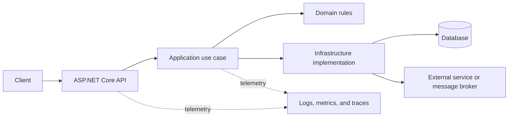
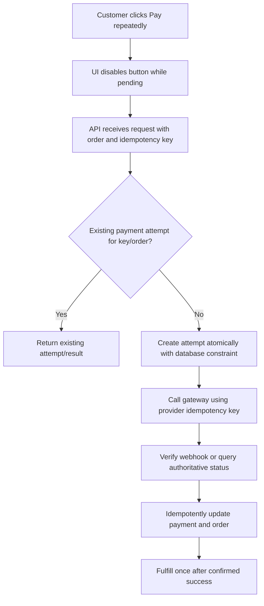

# Backend, C#, Payments & ASP.NET Core - Interview Q&A

Use these as interview answer frameworks, not scripts. Adapt architecture and payment examples to your actual project and payment provider. Do not claim production ownership or experience you cannot verify. The SQL examples and results below are for SQL Server.

## Table of Contents

- [1. Project architecture](#1-can-you-explain-your-project-architecture-what-architecture-are-you-following-in-your-project)
- [2. Clean Architecture](#2-what-is-clean-architecture-explain-its-layers-and-principles)
- [3. Value types vs. reference types](#3-what-is-the-difference-between-value-type-and-reference-type-in-c)
- [4. `ref`, `in`, and `out`](#4-what-is-the-difference-between-ref-in-and-out-parameters-in-c)
- [5. CORS in ASP.NET Core](#5-what-is-cors-why-is-cors-required-in-aspnet-core-web-api)
- [6. Common CORS problems and fixes](#6-what-problems-can-occur-because-of-cors-and-how-can-we-resolve-them)
- [7. Infinite `for` loop](#7-write-an-infinite-for-loop-in-c)
- [8. Payment gateway integration flow](#8-how-did-you-integrate-a-payment-gateway-in-your-project-explain-the-complete-payment-flow)
- [9. Verifying payment success](#9-how-did-you-verify-whether-a-payment-was-actually-successful)
- [10. Preventing duplicate payments](#10-how-would-you-prevent-multiple-payments-for-the-same-order)
- [11. SQL: `SELECT (5 + 3)`](#11-sql-is-this-query-valid-if-yes-what-will-be-the-result)
- [12. SQL: `COUNT(3) + COUNT(5)`](#12-sql-is-this-query-valid-if-yes-what-will-be-the-result)
- [13. SQL Server: `MAX(5 / 3)`](#13-sql-is-this-query-valid-if-yes-what-will-be-the-result-in-sql-server)
- [14. Dependency Injection](#14-what-is-dependency-injection-di-in-aspnet-core-why-do-we-use-it)
- [15. ASP.NET Core service lifetimes](#15-what-are-the-different-service-lifetimes-in-aspnet-core-explain-addtransient-addscoped-and-addsingleton)
- [16. ASP.NET Core middleware](#16-what-is-middleware-in-aspnet-core-how-does-the-middleware-pipeline-work)
- [17. Middleware ordering](#17-why-is-the-order-of-middleware-important-in-aspnet-core)

## 1. Can you explain your project architecture? What architecture are you following in your project?

**Adaptable sample answer:**

"In **[project name]**, we use **[the architecture your team actually uses, for example a layered or Clean Architecture style]**. The presentation/API layer handles HTTP concerns such as routing, authentication, request validation, and response codes. It delegates use cases to application services, which coordinate the business operation. Domain models and rules capture important business behavior. Infrastructure implements persistence and integrations such as the database, messaging, and external APIs. Dependency injection connects the implementations to the abstractions."

"For example, a request to **[real feature]** enters **[endpoint/controller]**, invokes **[service/use case]**, applies **[relevant business rule]**, and reads or updates **[data store/integration]**. My contribution was **[specific work you personally did]**. The architecture helps isolate changes and test business behavior, but I would describe the actual project boundaries and tradeoffs rather than claim it follows a pattern that it does not."



## 2. What is Clean Architecture? Explain its layers and principles.

**Sample answer:**

"Clean Architecture organizes software so that business policy is independent of delivery mechanisms and infrastructure. Its key rule is the **Dependency Rule**: source-code dependencies point inward, toward higher-level policy. The domain should not depend on ASP.NET Core, a database provider, or a particular UI."

"A common arrangement is:

- **Domain:** Entities, value objects, and core business rules/invariants. It should have minimal external dependencies.
- **Application:** Use cases, orchestration, application-level validation, and abstractions needed by those use cases, such as repository or gateway interfaces.
- **Infrastructure:** Implementations for databases, external APIs, file systems, and message brokers. It depends on inner-layer abstractions.
- **Presentation/API:** HTTP endpoints, request/response models, authentication integration, and user-facing protocol concerns.
- **Composition root:** The host or startup code wires interfaces to implementations using dependency injection."

"The outer layer can depend on inner layers, but inner layers should not depend on the outer layers. For example, an application use case can depend on an `IOrderRepository` abstraction; an infrastructure adapter implements it using EF Core. This makes business behavior easier to test and infrastructure easier to replace. Clean Architecture is not a requirement to create many projects or interfaces: I use the boundaries that provide real separation, and avoid ceremony for a small application."

## 3. What is the difference between Value Type and Reference Type in C#?

| Aspect | Value type | Reference type |
|---|---|---|
| Assignment/passing | Copies the value (unless passed by `ref`, `in`, or `out`) | Copies the reference; variables can refer to the same object |
| Typical examples | `int`, `bool`, `enum`, `struct`, `DateTime` | `class`, `string`, arrays, delegates |
| Default state | Usually the type's zero/default value | `null` is possible unless constrained by nullable-reference analysis |
| Equality | Depends on the type; many structs compare values | Often identity by default for classes, but can be overridden |

**Sample answer:**

"A value-type variable contains its value. Assigning it to another variable normally copies that value, so changing one copy does not change the other. A reference-type variable contains a reference to an object; assigning the variable copies the reference, so both variables can refer to the same object and observe its mutations. The simplified explanation that value types are always on the stack and reference types are always on the heap is not correct: storage depends on context, and the runtime manages object lifetimes. I choose structs for small, value-like data when their copying and mutability semantics are appropriate, and classes for identity-bearing or larger mutable objects."

```csharp
int first = 10;
int second = first;
second = 20; // first is still 10

var a = new List<int> { 1 };
var b = a;
b.Add(2); // a also refers to the list containing 1 and 2
```

## 4. What is the difference between `ref`, `in`, and `out` parameters in C#?

| Modifier | Must be assigned before the call? | Can the called method assign it? | Main use |
|---|---:|---:|---|
| `ref` | Yes | Yes | Read and update the caller's variable |
| `in` | Yes | No; the parameter is readonly within the method | Pass a value by readonly reference, often for larger structs |
| `out` | No | Yes; must be assigned before the method returns normally | Return an additional value through a parameter |

**Sample answer:**

"All three pass a variable by reference, but their initialization and mutation rules differ. With `ref`, the caller initializes the variable and the method may read or replace it. With `in`, the caller supplies an initialized value and the method receives a readonly reference. With `out`, the caller does not need to initialize the variable first, but the method must assign it before returning."

```csharp
static void AddOne(ref int value) => value++;

static int Read(in int value) => value;

static bool TryParse(string text, out int value) =>
    int.TryParse(text, out value);

int count = 4;
AddOne(ref count);
int snapshot = Read(in count);
bool parsed = TryParse("42", out int number);
```

"I use `out` for Try-pattern APIs, `ref` only when the caller's variable genuinely needs to be updated, and `in` when readonly by-reference passing is useful. For ordinary APIs, returning a value or a small result type is often clearer."

## 5. What is CORS? Why is CORS required in ASP.NET Core Web API?

**Sample answer:**

"CORS—Cross-Origin Resource Sharing—is a browser security mechanism that controls whether JavaScript running on one origin can read responses from another origin. An origin is the scheme, host, and port. For requests that need preflight, the browser first sends an `OPTIONS` request and checks the server's CORS response headers before sending the actual request."

"In ASP.NET Core, I configure a policy for the intended frontend origins, methods, and headers, then apply it globally or to selected endpoints. CORS allows a browser-based frontend hosted on a different origin to call the API when permitted. It is not authentication or authorization, and it does not prevent direct requests from servers, command-line clients, or malicious non-browser clients."

## 6. What problems can occur because of CORS, and how can we resolve them?

**Sample answer:**

"CORS failures often result from a mismatch between the browser's request and the API policy. I inspect the browser console and network tab, especially the preflight `OPTIONS` request, response status, and `Access-Control-*` headers. Common causes and fixes include:"

- **Wrong origin:** Scheme, host, and port must match the configured origin exactly. Add the correct development or production origin; do not guess with broad wildcards.
- **Preflight rejected or routed incorrectly:** Ensure `OPTIONS` is not blocked by a proxy, authentication layer, or endpoint configuration. Configure CORS at the correct point in the middleware pipeline.
- **Missing method or request header:** Allow only the required methods and headers (for example, `Authorization` or a custom request header) in the policy.
- **Credentials with wildcard origin:** A credentialed browser request cannot use `Access-Control-Allow-Origin: *`. Specify the exact allowed origin and configure credentials only when needed.
- **CORS middleware missing or ordered incorrectly:** In a typical explicit endpoint-routing pipeline, use routing, then CORS, then authentication and authorization, then map/execute endpoints.
- **Redirect or server error on preflight:** A redirect, 401, 404, or 500 on `OPTIONS` is not a successful CORS response. Correct the route/proxy/authentication behavior and return the appropriate CORS headers.
- **Assuming CORS secures an API:** Keep authentication, authorization, CSRF protections where relevant, and input validation separate; CORS only governs browser access to responses.

"I would fix the server or proxy configuration that causes the mismatch and retest from the actual browser origin. I would not use `AllowAnyOrigin` as a quick production fix, especially with credentials."

## 7. Write an infinite `for` loop in C#.

```csharp
for (;;)
{
    // Repeats until the process exits or the loop is interrupted.
}
```

"A `for` loop with no initializer, condition, or iterator runs indefinitely; `while (true)` is another form. In real application code, an infinite worker loop should have a deliberate stop condition, cancellation token, delay or blocking wait, and error handling so it does not consume CPU continuously or prevent graceful shutdown."

```csharp
while (!stoppingToken.IsCancellationRequested)
{
    await ProcessNextItemAsync(stoppingToken);
}
```

## 8. How did you integrate a Payment Gateway in your project? Explain the complete payment flow.

**Adaptable sample answer:**

"I would describe the gateway and implementation I actually used. In a typical integration, the backend first validates the order and calculates the amount and currency from trusted server-side data. It creates or retrieves a pending payment record with a unique internal order/payment reference and an idempotency key. The backend then calls the provider's API—preferably using a hosted checkout or provider tokenization flow—and returns only the checkout URL or client-safe payment data required by the frontend. Card details should go directly to the provider; our application should not store raw card numbers or security codes."

"The customer completes authentication and payment with the provider. The browser may return to a success or failure page, but that redirect is only a user-experience signal, not proof of payment. The provider sends a signed webhook to our backend, or the backend queries the provider using its server-side credentials. We verify the webhook signature, provider account, amount, currency, payment/order reference, and event identity; we handle duplicate or out-of-order events safely. In a local database transaction, we update the payment/order state idempotently and record the provider event. Only after confirmed success do we trigger fulfillment, ideally through an outbox or another reliable mechanism."

```mermaid
sequenceDiagram
    participant U as Customer
    participant UI as Frontend
    participant API as Merchant API
    participant DB as Order and payment store
    participant PG as Payment gateway
    participant W as Outbox worker
    participant F as Fulfillment
    U->>UI: Click Pay
    UI->>API: Create payment for order
    API->>DB: Validate order; create pending payment and idempotency key
    API->>PG: Create checkout/payment intent
    PG-->>API: Checkout URL or client-safe payment data
    API-->>UI: Checkout details
    UI->>PG: Customer completes provider-hosted payment
    PG-->>UI: Redirect (display status only)
    PG->>API: Signed payment webhook
    API->>API: Verify signature and event/payment details
    API->>DB: Transaction: record payment and fulfillment outbox event
    DB-->>API: Commit
    API-->>PG: Acknowledge webhook
    W->>DB: Read unpublished outbox event
    DB-->>W: Confirmed payment event
    W->>F: Fulfill order idempotently
```

"I would also explain how we handle authorization versus capture if the provider supports both, failed or pending payments, timeouts, refunds, reconciliation, logging, and production secrets. I would never log card data, authentication secrets, or full payment tokens."

## 9. How did you verify whether a payment was actually successful?

**Adaptable sample answer:**

"I did not treat a frontend redirect, button state, or client-supplied `success` value as authoritative. The backend considered a payment successful only after verifying a trusted server-side signal: a correctly signed provider webhook, or a server-to-server status lookup using provider credentials. I matched the provider's payment/reference ID to our pending order and checked the expected amount, currency, merchant/account, and final status. If the provider distinguishes authorization from capture, I used the state required by the business before fulfillment."

"I processed the result idempotently and persisted the provider event and state transition. If the webhook was delayed, duplicated, or out of order, I kept the order pending until the authoritative status was known and used retries or scheduled reconciliation against the provider. The UI displayed a pending state when confirmation had not arrived; it did not claim success prematurely."

## 10. How would you prevent multiple payments for the same order?

**Sample answer:**

"I would use defense in depth. In the UI, I disable the Pay button while the request is pending and show progress, but I do not rely on that for correctness. The backend creates one payment attempt for a logical order/payment operation and uses a stable idempotency key when calling the provider. Repeated requests with the same key return the existing attempt/result instead of creating a new charge."

"I would enforce the business invariant in the database—for example, a unique constraint for the active payment attempt or successful payment per order, depending on the payment and retry model. The API should atomically check/update the order state so concurrent requests cannot both pass a check-then-insert race. Webhook processing is also idempotent by provider event ID and payment reference. Failed attempts may permit a new attempt according to explicit rules; I would not block legitimate retries forever. I would reconcile uncertain outcomes, because a network timeout does not mean the provider failed to process the payment."



## 11. SQL: Is this query valid? If yes, what will be the result?

```sql
SELECT (5 + 3);
```

**Answer:** Yes. In SQL Server, this returns one row and one unnamed expression column containing **`8`**. The parentheses group the arithmetic expression; they do not change the result.

## 12. SQL: Is this query valid? If yes, what will be the result?

```sql
SELECT COUNT(3) + COUNT(5);
```

**Answer:** Yes. In SQL Server, a `SELECT` without a `FROM` clause evaluates the scalar expressions for one implicit row. Both `3` and `5` are non-`NULL` expressions, so each `COUNT(expression)` is `1`; the result is **`2`**.

"`COUNT(expression)` counts non-`NULL` values in the input rows; it does not return the numeric value inside the expression. With a table, the result would depend on the number of rows and whether each expression evaluated to `NULL`. For comparison, `COUNT(*)` counts rows regardless of `NULL` values."

## 13. SQL: Is this query valid? If yes, what will be the result in SQL Server?

```sql
SELECT MAX(5 / 3);
```

**Answer:** Yes. In SQL Server, both literals are integers, so integer division gives `5 / 3 = 1` (the fractional part is truncated). With no `FROM` clause, the scalar aggregate operates on the single implicit row, and `MAX(1)` returns **`1`**.

"If fractional division is intended, use a decimal operand, for example `5.0 / 3` or `CAST(5 AS decimal(10, 2)) / 3`; that expression evaluates to approximately `1.666666...` before any explicit rounding."

## 14. What is Dependency Injection (DI) in ASP.NET Core? Why do we use it?

**Sample answer:**

"Dependency Injection is a technique for supplying a class with the dependencies it needs instead of having it construct concrete dependencies itself. In ASP.NET Core, services are registered with the built-in container and typically supplied through constructor injection. For example, a controller can depend on an `IOrderService`; the host supplies the registered implementation."

"DI reduces coupling, centralizes object construction and lifetime management, and makes it easier to replace dependencies in tests or at composition time. I register abstractions when they create a useful boundary, avoid service-locator patterns, and keep constructors explicit. DI does not automatically make an architecture testable; classes still need clear responsibilities and dependencies."

```csharp
builder.Services.AddScoped<IOrderService, OrderService>();

public sealed class OrdersController(IOrderService orderService) : ControllerBase
{
    private readonly IOrderService _orderService = orderService;
}
```

## 15. What are the different service lifetimes in ASP.NET Core? Explain `AddTransient`, `AddScoped`, and `AddSingleton`.

| Registration | Lifetime | Typical use | Important caution |
|---|---|---|---|
| `AddTransient` | A new instance each time the service is resolved | Small, stateless, inexpensive services | Repeated construction can be costly if the service is expensive |
| `AddScoped` | One instance per scope; typically one per HTTP request | Request-oriented work, commonly EF Core `DbContext` | Do not share a scoped instance across concurrent operations |
| `AddSingleton` | One instance for the application host's lifetime | Thread-safe shared services or immutable data | Must be thread-safe and must not capture scoped services |

**Sample answer:**

"I choose the lifetime based on state and resource ownership. `AddTransient` creates a new instance for each resolution. `AddScoped` shares an instance within a scope, normally one HTTP request in a web API. `AddSingleton` shares one instance for the application's lifetime. `DbContext` is normally scoped and should not be used concurrently. A singleton must not directly capture a scoped service. A background service that needs scoped dependencies should create a scope for each unit of work."

## 16. What is Middleware in ASP.NET Core? How does the middleware pipeline work?

**Sample answer:**

"Middleware is a component in the HTTP request pipeline. A middleware can inspect or modify the request, call the next component, inspect or modify the response on the way back, or short-circuit the pipeline and return a response itself. Middleware is composed in registration order; the request travels forward through the pipeline and the response unwinds in reverse order."

"Typical middleware responsibilities include exception handling, HTTPS redirection, static files, routing, CORS, authentication, authorization, and endpoint execution. Middleware is appropriate for cross-cutting HTTP concerns. For MVC action-specific behavior, filters may be a better fit."

```text
Request  -> Exception handling -> Routing -> Authentication -> Authorization -> Endpoint
Response <- Exception handling <- Routing <- Authentication <- Authorization <- Endpoint
```

## 17. Why is the order of middleware important in ASP.NET Core?

**Sample answer:**

"Each middleware runs at a particular point and may depend on data established by earlier middleware. If the order is wrong, required metadata or identity may not yet exist, a request may be handled too early, or security checks may be skipped. For example, routing should select endpoint metadata before endpoint-aware CORS and authorization run; authentication must establish the user before authorization evaluates policies."

"A typical explicit order for a controller API is:"

```csharp
app.UseExceptionHandler("/error"); // If using an error endpoint, configure it appropriately.
app.UseHttpsRedirection();
app.UseRouting();
app.UseCors("Frontend");
app.UseAuthentication();
app.UseAuthorization();
app.MapControllers();
```

"The exact pipeline can vary with hosting model, static files, forwarded headers, and other requirements, so I verify the current ASP.NET Core guidance and the application's actual setup. I do not put authentication after authorization, and I configure CORS before endpoint execution so preflight requests and endpoint metadata are handled correctly."
