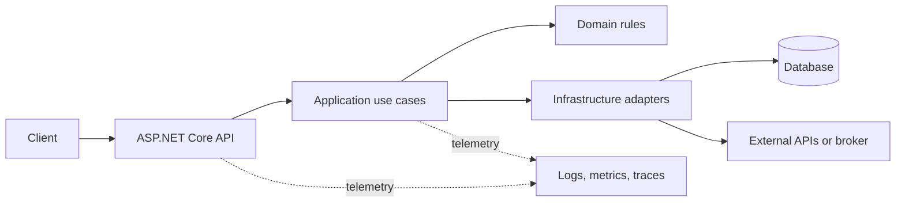
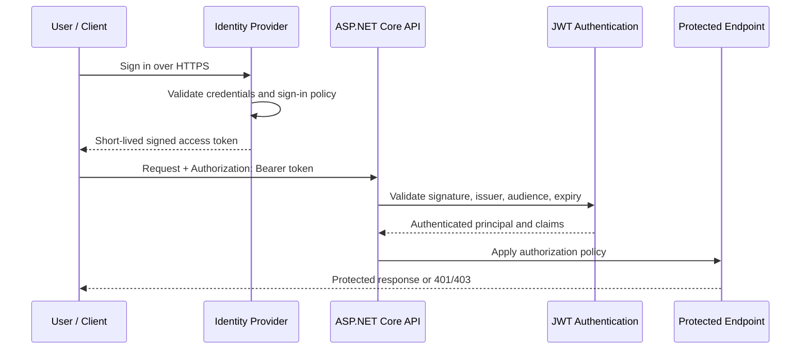
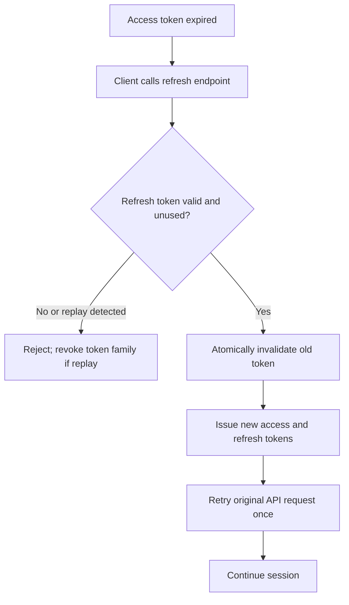
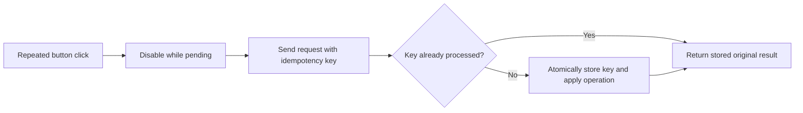
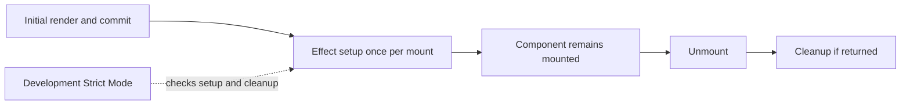
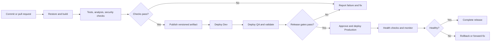

# Thoughtsoul Info - Interview Questions

Use these as spoken-answer frameworks, not scripts. Tailor project, technology, and deployment examples to what you have actually done. In particular, replace the EF Core experience prompt with your real project details; do not claim tools, ownership, or outcomes you cannot verify.

## Table of Contents

- [Backend Architecture and ASP.NET Core](#backend-architecture-and-aspnet-core)
  - [1. Backend project structure and architecture](#1-how-do-you-generally-structure-your-backend-project-can-you-explain-your-project-architecture)
  - [2. JWT authentication flow](#2-can-you-explain-the-complete-authentication-flow-using-jwt-how-would-you-build-jwt-authentication-from-scratch)
  - [3. JWT token expiry](#3-how-do-you-handle-jwt-token-expiry)
  - [4. Refresh token functionality](#4-how-do-you-implement-refresh-token-functionality)
  - [5. ASP.NET Core middleware order](#5-what-is-the-correct-order-of-middleware-in-aspnet-core)
  - [6. Routing, CORS, authentication, and authorization order](#6-suppose-we-have-routing-cors-authentication-and-authorization-middleware-what-would-be-the-correct-order-and-why)
  - [7. CORS in ASP.NET Core Web API](#7-what-is-cors-why-do-we-use-it-in-aspnet-core-web-api)
  - [8. Singleton, Scoped, and Transient lifetimes](#8-can-you-explain-singleton-scoped-and-transient-service-lifetimes-in-aspnet-core)
- [C# and LINQ](#c-and-linq)
  - [9. async and await in C#](#9-what-is-async-and-await-in-c-why-do-we-use-them)
  - [10. LINQ in C#](#10-what-is-linq-in-c)
  - [11. Deferred execution in LINQ](#11-what-is-deferred-execution-in-linq-can-you-explain-with-an-example)
- [ASP.NET Core API Features](#aspnet-core-api-features)
  - [12. ASP.NET Core filters](#12-what-are-filters-in-aspnet-core-what-are-the-different-types-of-filters)
  - [13. API rate limiting](#13-what-is-rate-limiting-why-is-it-required-for-apis)
  - [14. Preventing duplicate API requests](#14-how-do-you-prevent-duplicate-api-requests-when-a-user-clicks-a-button-multiple-times)
- [Entity Framework Core, APIs, and SQL Server](#entity-framework-core-apis-and-sql-server)
  - [15. EF Core loading strategies](#15-what-is-the-difference-between-eager-loading-lazy-loading-and-explicit-loading-in-entity-framework-core)
  - [16. EF Core project experience](#16-do-you-have-experience-with-entity-framework-core-explain-how-you-have-used-ef-core-in-your-projects)
  - [17. Diagnosing and optimizing a slow API](#17-suppose-you-have-a-slow-api-how-would-you-identify-the-problem-and-optimize-the-api)
  - [18. SQL Server composite indexes](#18-what-is-a-composite-index-in-sql-server-when-would-you-use-it)
  - [19. Clustered vs. non-clustered indexes](#19-what-is-the-difference-between-clustered-index-and-non-clustered-index)
  - [20. SQL Server CTEs](#20-what-is-a-cte-common-table-expression-in-sql-server-when-would-you-use-it)
- [React](#react)
  - [21. `useEffect`](#21-what-is-useeffect-in-reactjs)
  - [22. Empty `useEffect` dependency array](#22-what-happens-when-we-pass-an-empty-dependency-array-to-useeffect)
- [Azure and Delivery](#azure-and-delivery)
  - [23. Azure Functions vs. a Web API](#23-what-is-azure-functions-how-is-it-different-from-a-traditional-web-api)
  - [24. Azure App Service environment variables](#24-how-do-you-configure-environment-variables-in-azure-app-service)
  - [25. Dev, QA, and Production deployments](#25-how-would-you-separate-dev-qa-and-production-deployments)
  - [26. CI/CD pipeline flow](#26-what-is-a-cicd-pipeline-can-you-explain-the-complete-flow)

## Backend Architecture and ASP.NET Core

### 1. How do you generally structure your backend project? Can you explain your project architecture?

**Sample answer:**

"I structure a backend around clear responsibilities and business capabilities. The API layer owns HTTP concerns such as routing, request/response contracts, authentication, and status codes. It delegates use cases to an application or service layer, where orchestration and business rules live. Domain models hold important business concepts and invariants where the complexity warrants it. Infrastructure contains implementations for persistence, messaging, external APIs, and other technical integrations. Dependency injection connects these parts while keeping business rules independent of infrastructure details."

"For persistence, I use EF Core or another data-access approach behind a useful boundary. I avoid adding a repository or abstraction that only forwards every call without improving testing, ownership, or change isolation. I keep configuration and secrets outside source code, and add centralized exception handling, structured logging, validation, health checks, and tests at the appropriate boundaries."



"The exact project layout depends on the size of the system. For a small API, a modular structure in one deployable application may be simpler than multiple projects or microservices. For a larger system, I would align modules with business capabilities and define explicit dependencies."

### 2. Can you explain the complete authentication flow using JWT? How would you build JWT authentication from scratch?

**Sample answer:**

"A user submits credentials over HTTPS to an authentication system. The server validates those credentials against the configured identity store, applies relevant account and sign-in policies, and issues a short-lived signed access token containing the required claims, issuer, audience, and expiry. The client sends that access token in the `Authorization: Bearer` header when calling a protected API. ASP.NET Core's JWT bearer handler validates the token's signature, issuer, audience, and lifetime before creating the authenticated `ClaimsPrincipal`. Authorization policies then decide whether that identity may perform the requested operation."



"If implementing the token-issuing component, I would use a well-maintained identity provider or security library rather than inventing cryptography or a token format. I would protect signing keys in a managed secret/key store, support rotation and key identifiers, use strong approved algorithms, issue only necessary claims, and keep access tokens short-lived. The API should never trust a token just because it can decode its Base64 payload; signature and claim validation are essential. In a production system, authentication and authorization also need brute-force protections, audit logging, account lifecycle controls, and a secure refresh-token design."

### 3. How do you handle JWT token expiry?

**Sample answer:**

"The access token includes an expiry (`exp`) claim, and the API validates its lifetime on every request. I keep access tokens relatively short-lived so a stolen token has a limited useful window, while allowing a small, carefully configured clock skew for differences between server clocks. I do not extend an expired token just because the client asks; the client must obtain a new access token through the approved authentication or refresh flow."

"When a protected API returns `401 Unauthorized` because a token has expired, the client can attempt one refresh if it has a valid refresh credential. If refresh fails or the refresh credential has expired or been revoked, the client clears its authentication state and requires sign-in again. The client should avoid infinite refresh loops and should not send a refresh token to ordinary resource APIs. The server should distinguish authentication failure (`401`) from an authenticated caller who lacks permission (`403`)."

### 4. How do you implement Refresh Token functionality?

**Sample answer:**

"After successful authentication, the identity system issues a short-lived access token and a longer-lived refresh token. The access token is sent to APIs; the refresh token is sent only to the token endpoint. At refresh, the server validates the refresh token's identity, expiry, revocation state, and binding to the client or session. It then rotates the refresh token—issues a new one and invalidates the previous one—and returns a new access token. Rotation limits replay: if an already-used refresh token appears again, the server can revoke the associated token family or session and require reauthentication."

"I would store refresh tokens securely and, where possible, store only a cryptographic hash server-side. The record should include the user/session, creation and expiry times, revocation or replacement state, and enough metadata for audit and replay detection. Logout, password reset, suspicious activity, and administrative revocation should invalidate relevant sessions. For browser applications, I would choose storage based on the threat model; a `Secure`, `HttpOnly`, appropriately `SameSite` cookie can reduce JavaScript access to a refresh credential, but cookie-based flows also need CSRF protections. I would not store long-lived credentials in `localStorage` by default."



### 5. What is the correct order of middleware in ASP.NET Core?

**Sample answer:**

"Middleware order matters because requests pass through the pipeline in registration order and responses unwind in reverse order. There is no single universal list because applications may have HTTPS redirection, static files, forwarded headers, exception handling, routing, CORS, authentication, authorization, and endpoint-specific middleware. I place each component according to its dependencies and the security requirements of the application."

"For a typical controller-based API, I would configure exception handling and HTTPS/forwarded-header handling early as appropriate, then routing, CORS, authentication, authorization, and finally map endpoints. Static-file middleware, if used, is usually placed where it can serve files without unnecessarily entering protected endpoint logic. I would follow the hosting model's current ASP.NET Core guidance and verify the effective pipeline, especially when using minimal hosting or endpoint-specific middleware."

### 6. Suppose we have Routing, CORS, Authentication and Authorization middleware. What would be the correct order and why?

**Answer:**

```csharp
app.UseRouting();
app.UseCors("Frontend");
app.UseAuthentication();
app.UseAuthorization();
app.MapControllers();
```

"Routing selects the endpoint and its metadata. CORS must run after routing so endpoint-specific CORS metadata can be considered, and before authentication/authorization and endpoint execution so browser preflight requests can be handled correctly. Authentication establishes the user principal. Authorization then evaluates that principal against endpoint policies. Mapping or executing the endpoint comes after those checks. In the minimal hosting model, `WebApplication` can add some middleware automatically, but when explicit ordering is used, this is the standard order to remember. The CORS policy should allow only the intended origins, methods, and headers; CORS is not an authentication mechanism."

### 7. What is CORS? Why do we use it in ASP.NET Core Web API?

**Sample answer:**

"Cross-Origin Resource Sharing (CORS) is a browser-enforced mechanism that controls whether a web page from one origin may make certain requests to a different origin. An origin is the combination of scheme, host, and port. A browser may send a preflight `OPTIONS` request before the actual request when the method or headers require it. The API responds with CORS headers that tell the browser whether the requesting origin is permitted."

"In ASP.NET Core, I configure a named or default CORS policy for known frontend origins, methods, and headers, then apply it globally or to selected endpoints. I avoid allowing every origin in production unless there is a specific, justified requirement. When credentials such as cookies are allowed, the origin must be explicit rather than `*`, and cookie-based authentication needs appropriate CSRF protection. CORS is enforced by browsers; it does not block a direct request from a script, server, or command-line client, and it does not replace authentication or authorization."

### 8. Can you explain Singleton, Scoped and Transient service lifetimes in ASP.NET Core?

| Lifetime | Instance behavior | Typical use | Caution |
|---|---|---|---|
| Transient | A new instance each time it is requested from the container | Lightweight, stateless services | Avoid expensive construction or hidden shared state |
| Scoped | One instance per scope; typically one per HTTP request in a web app | Request-oriented work such as an EF Core `DbContext` | Do not use concurrently from unrelated parallel operations |
| Singleton | One instance for the application's lifetime | Thread-safe shared services and immutable configuration helpers | Must be thread-safe; must not capture scoped services |

**Sample answer:**

"I choose a lifetime based on ownership and state, not just performance. A `DbContext` is normally scoped so one request uses a bounded unit of work. A transient service is useful when it is stateless and cheap to construct. A singleton is shared across requests, so all mutable state must be synchronized or avoided. A singleton must not directly depend on a scoped service, because that would effectively keep a request-scoped object alive for the application's lifetime. For hosted services or background jobs that need scoped dependencies, I create a scope per unit of work."

## C# and LINQ

### 9. What is async and await in C#? Why do we use them?

**Sample answer:**

"`async` and `await` make asynchronous control flow easier to write and read. An asynchronous method commonly returns `Task`, `Task<T>`, or, for streaming, `IAsyncEnumerable<T>`. When it awaits an incomplete I/O operation—such as a database or HTTP call—the method yields control rather than blocking a thread while waiting. When the operation completes, execution resumes and produces the result or propagates the exception."

"This improves scalability for I/O-bound server workloads because request threads are not occupied just waiting on network or disk I/O. It does not make CPU-bound work faster by itself, and `async` does not automatically run code on another thread. I use asynchronous APIs end to end, pass cancellation tokens through long-running operations, avoid `.Result` and `.Wait()` in request paths, and do not wrap ordinary asynchronous I/O in `Task.Run`."

### 10. What is LINQ in C#?

**Sample answer:**

"LINQ—Language Integrated Query—provides a consistent way to query and transform data in C#. Query operators such as `Where`, `Select`, `OrderBy`, and `GroupBy` are available as method syntax or query syntax. LINQ over an in-memory collection typically uses `IEnumerable<T>` and delegates; LINQ providers such as EF Core use `IQueryable<T>` to translate supported expression trees into a remote query, such as SQL."

"The distinction matters: an `IQueryable` query is usually translated and executed by its provider, while an `IEnumerable` query runs in the application process. I keep filters, projections, ordering, and paging on the database side when appropriate, project only required columns, and avoid accidentally materializing a large result set before filtering."

### 11. What is Deferred Execution in LINQ? Can you explain with an example?

**Sample answer:**

"Deferred execution means a query is defined now but runs when it is enumerated. Many LINQ operators such as `Where` and `Select` are deferred; terminal operations such as `ToList`, `First`, `Count`, or a `foreach` trigger execution. This allows query composition, but it also means the source may be read later, multiple times, or after its state has changed."

```csharp
var numbers = new List<int> { 1, 2, 3 };
var evenNumbers = numbers.Where(n => n % 2 == 0); // Query is defined, not enumerated.

numbers.Add(4);

foreach (var number in evenNumbers) // Query executes here.
{
    Console.WriteLine(number); // 2, then 4
}
```

"Calling `ToList()` would execute the query immediately and take a snapshot of the results at that point. In EF Core, repeated enumeration of an `IQueryable` can execute multiple database queries, so I materialize deliberately when I need a stable result or want to avoid repeating expensive work."

## ASP.NET Core API Features

### 12. What are Filters in ASP.NET Core? What are the different types of filters?

**Sample answer:**

"Filters are components in the MVC/controller action pipeline that run before or after selected stages of action execution. They can handle cross-cutting concerns that specifically need MVC action or result context. The main filter types are:

- **Authorization filters:** Run early to enforce authorization. Prefer ASP.NET Core's authorization policies and attributes for normal authorization.
- **Resource filters:** Run around most of the rest of the MVC pipeline, useful for concerns such as short-circuiting or controlling resource work.
- **Action filters:** Run before and after an action method.
- **Exception filters:** Handle certain unhandled exceptions in MVC action execution. Central exception-handling middleware is usually a better general application-wide exception boundary.
- **Result filters:** Run before and after action-result execution.
- **Endpoint filters:** Available for Minimal APIs (and supported endpoint scenarios); wrap endpoint handler execution and can inspect or change arguments/results."

"Filters can be synchronous or asynchronous and may be registered globally, on a controller, or on an action, depending on the filter type. I choose middleware for concerns that apply broadly to HTTP requests, and filters when the concern requires MVC/action-specific context. I avoid duplicating the same responsibility in multiple layers."

### 13. What is Rate Limiting? Why is it required for APIs?

**Sample answer:**

"Rate limiting restricts how many requests a caller or resource can make within a defined interval or concurrency limit. It protects service capacity, helps control noisy neighbors and accidental request bursts, and can reduce some abuse and denial-of-service exposure. ASP.NET Core provides rate-limiting middleware with policies such as fixed-window, sliding-window, token-bucket, and concurrency limiters."

"I would choose a policy based on the endpoint and traffic pattern, partition fairly by an authenticated user, tenant, or API key where appropriate, and return `429 Too Many Requests` with a useful retry signal when supported. For a multi-instance service, I would verify whether the limiter is local to each instance or backed by shared state; a per-process limit is not automatically a global quota. I would monitor rejected requests and ensure health, authentication, and critical recovery paths are not accidentally blocked. Rate limits complement, but do not replace, authentication, authorization, input validation, and upstream DDoS protection."

### 14. How do you prevent duplicate API requests when a user clicks a button multiple times?

**Sample answer:**

"I handle duplicate submission at both the user interface and the server because a disabled button alone cannot prevent retries, duplicated network delivery, or requests from another client. In the UI, I disable the submit action while the request is in flight, show progress, and prevent duplicate event handling. The client can also cancel obsolete reads, but cancellation does not prove that the server did not already process a request."

"For operations that must not be applied twice—such as creating a payment or order—I use an idempotency key generated for the logical operation. The API validates the key and stores it with the operation/result under a uniqueness constraint, so a repeated request returns the original outcome rather than applying the side effect again. I also use database constraints to protect important invariants. The idempotency record and business update must be persisted consistently, and keys need a defined scope and retention policy. For simple create operations, a unique business key may be sufficient. I do not rely on arbitrary time-based debouncing as the only correctness control."



## Entity Framework Core, APIs, and SQL Server

### 15. What is the difference between Eager Loading, Lazy Loading and Explicit Loading in Entity Framework Core?

| Loading style | When related data is loaded | Common EF Core mechanism | Tradeoff |
|---|---|---|---|
| Eager | As part of the initial query | `Include` / `ThenInclude`, or projection | Can fetch more data or create large joins if overused |
| Lazy | Automatically when a navigation property is accessed | Lazy-loading proxies or `ILazyLoader` when configured | Convenient, but can cause hidden queries and N+1 performance problems |
| Explicit | Deliberately after the initial query | `Entry(entity).Reference(...).LoadAsync()` or `.Collection(...).LoadAsync()` | Precise control, but requires additional code and often another query |

**Sample answer:**

"I choose the loading strategy based on the data required by the use case. For a read API, I often project directly into a DTO so the database returns only the necessary columns. Eager loading is appropriate when related data is definitely needed and the query shape is controlled. Lazy loading can make access look simple, but I use it cautiously because property access can trigger extra round trips, especially in loops. Explicit loading is useful when I only know later that a related collection is needed. I inspect generated SQL and query counts rather than choosing by habit."

### 16. Do you have experience with Entity Framework Core? Explain how you have used EF Core in your projects.

**Adaptable answer (replace brackets with true details):**

"I have used EF Core in **[project or type of application]** with **[database/provider]**. I used `DbContext` as a scoped unit of work, mapped **[entities and relationships]**, and implemented **[queries, inserts, updates, or transactions]** for **[specific feature]**. For reads, I used **[projection / `AsNoTracking` / eager loading / pagination]** where appropriate. For schema evolution, I used **[migrations or the actual team process]** and coordinated changes with deployment requirements."

"A performance or correctness issue I worked on was **[real example]**. I investigated it using **[generated SQL, query plan, logs, profiler, or metrics]** and addressed it by **[specific change]**. I tested **[relevant cases]**. I distinguish my contribution from the team's broader work, and I would be clear if my experience is limited to learning projects rather than production systems."

Be prepared to describe one real query and its SQL shape, how you handled concurrency and transactions, and a tradeoff you made. Do not state experience with a provider, migration process, or production system unless it is accurate.

### 17. Suppose you have a slow API. How would you identify the problem and optimize the API?

**Sample answer:**

"I would first quantify the issue by endpoint, percentile latency, request volume, errors, and recent changes. Then I would trace a slow request across middleware, application code, database, and downstream services. I would use metrics and distributed traces to find where time is spent rather than optimize based on guesswork."

"For database-bound latency, I would inspect query plans, indexes, lock waits, connection usage, generated SQL, N+1 patterns, and result size. I would add projection and pagination, remove unnecessary round trips, and tune indexes based on observed predicates and sort patterns. For application work, I would profile CPU and allocations, check sync-over-async and blocking, and use asynchronous I/O with cancellation. For external dependencies, I would inspect their latency and error rates, set timeouts, and use bounded retries only where safe. I would consider caching only for suitable data with a clear invalidation and staleness policy."

"After each targeted change, I would run representative load tests and compare p50/p95/p99 latency, throughput, errors, and resource use. I would deploy gradually and monitor to confirm the change improves the actual bottleneck without moving it elsewhere."

### 18. What is a Composite Index in SQL Server? When would you use it?

**Sample answer:**

"A composite index contains more than one key column in a defined order. For example:"

```sql
CREATE INDEX IX_Orders_CustomerId_CreatedAt
ON dbo.Orders (CustomerId, CreatedAt DESC)
INCLUDE (Status, TotalAmount);
```

"This index may support a query that filters by `CustomerId`, orders by `CreatedAt`, and returns `Status` and `TotalAmount`. The key-column order matters: SQL Server can generally seek efficiently on the leading key columns, so the index above is not equivalent to one beginning with `CreatedAt`. I choose key order based on real query predicates, joins, sort requirements, selectivity, and the execution plan. Included columns can cover selected output without making them index keys."

"Indexes speed some reads but cost storage and add work to inserts, updates, and deletes. I validate with actual workload and execution plans, avoid near-duplicate indexes, and do not add a composite index solely because a query has multiple conditions."

### 19. What is the difference between Clustered Index and Non-Clustered Index?

| Clustered index | Non-clustered index |
|---|---|
| Defines the table's row storage order at the leaf level of the index | Separate index structure that stores key values and row locators |
| Only one per table, because rows can have only one clustered ordering | Multiple can exist, within practical storage and write-cost limits |
| Often chosen for a stable, commonly used key or access pattern | Useful for alternate filters, joins, ordering, or covering queries |
| A wide clustered key increases locator size in non-clustered indexes | Can include non-key columns to cover queries |

**Sample answer:**

"A clustered index determines the order of the table's data rows at the leaf level, so a table can have only one. A non-clustered index is a separate B-tree structure whose leaf entries contain the index key and a row locator—often the clustered key for a clustered table. Non-clustered indexes can speed other access patterns, but they add storage and write overhead. I select indexes from query patterns and execution plans, and keep the clustered key appropriately narrow and stable."

### 20. What is a CTE (Common Table Expression) in SQL Server? When would you use it?

**Sample answer:**

"A CTE is a named query expression introduced with `WITH` and scoped to a single following statement. It can make a complex query easier to read by naming a logical intermediate result, and a recursive CTE can traverse hierarchical data such as an organization tree."

```sql
WITH RecentOrders AS
(
    SELECT OrderId, CustomerId, CreatedAt
    FROM dbo.Orders
    WHERE CreatedAt >= @StartDate
)
SELECT CustomerId, COUNT(*) AS OrderCount
FROM RecentOrders
GROUP BY CustomerId;
```

"A CTE is not automatically materialized or cached; SQL Server may inline or otherwise optimize it as part of the statement. Reusing the CTE name in a query does not necessarily mean the result is computed once. If I need to reuse a large intermediate result, index it, or control a multi-step operation, a temporary table may be more appropriate. For recursion, I include safeguards such as a sensible termination condition and consider recursion limits."

## React

### 21. What is `useEffect` in React.js?

**Sample answer:**

"`useEffect` is a React Hook for synchronizing a component with an external system after rendering. Examples include subscribing to an event source, updating a non-React widget, or performing a client-side request when that is appropriate for the application's data-fetching approach. The effect callback may return a cleanup function to unsubscribe, clear a timer, or abort/cancel work when dependencies change or the component is removed."

"Effects are not intended to calculate values that can be derived during rendering, nor to handle user actions that belong in an event handler. I list every reactive value used by the effect in its dependency array and follow the Hooks rules. For data fetching, I handle cancellation or stale responses and loading/error states; in larger applications, a framework loader or query library may be a better fit."

### 22. What happens when we pass an empty dependency array `[]` to `useEffect`?

**Sample answer:**

"An empty dependency array means the effect has no reactive dependencies, so React runs it after the component's initial commit and does not rerun it due to changes in props or state. If the effect returns cleanup, React runs that cleanup when the component is removed. In development, React Strict Mode may run an extra setup-and-cleanup cycle to help reveal effects that are not safe to repeat; this does not mean production performs the same extra cycle."

"An empty array is correct only if the effect truly does not need changing reactive values. It is not a way to suppress dependency warnings or force a class-style lifecycle. If an effect uses props, state, or values declared in the component, I either include those dependencies or restructure the code so the dependency behavior is correct."



## Azure and Delivery

### 23. What is Azure Functions? How is it different from a traditional Web API?

**Sample answer:**

"Azure Functions is a managed, event-driven compute service. A function runs in response to a trigger such as an HTTP request, timer, queue message, event, or storage change. It is a good fit for discrete background jobs, event processing, scheduled work, and some lightweight HTTP endpoints. Hosting plans and configuration determine scaling behavior, available resources, networking, and cost."

"A traditional ASP.NET Core Web API is usually a continuously available application that owns an HTTP routing surface and can serve many endpoints and long-lived request patterns. An HTTP-triggered Function can expose an API, but functions are commonly organized around triggers and individual operations. I choose based on lifecycle, request patterns, operational model, and scale needs—not just because one is newer. Long-running or complex workflows may need durable orchestration; a conventional API may be better for a stable, rich HTTP application."

### 24. How do you configure environment variables in Azure App Service?

**Sample answer:**

"In Azure App Service, application settings are configured under the app's configuration settings and are exposed to the application as environment variables. In .NET, hierarchical configuration keys use double underscores in environment variable names—for example, `ConnectionStrings__Main` maps to `ConnectionStrings:Main`. I can also configure settings through deployment automation or infrastructure as code so environments are repeatable."

"I do not commit secrets to the repository or put them in ordinary deployment logs. For secrets, I prefer managed identity with Azure Key Vault references or another managed secret store, apply least-privilege access, and rotate credentials. Slot-specific settings should be marked as deployment-slot settings so a swap does not accidentally move environment-specific values. I verify changes and restart behavior according to App Service configuration semantics, then test the deployed app using health checks and safe configuration validation."

### 25. How would you separate Dev, QA and Production deployments?

**Sample answer:**

"I would build an artifact once and promote that same version through Dev, QA, and Production, supplying environment-specific configuration at deployment time. This reduces the chance that each environment is running a different build. Each environment should have isolated resources and data, least-privilege identities, and no copied production secrets in lower environments. Configuration and infrastructure should be managed consistently, preferably as code."

"The pipeline would run automated checks before deployment, deploy first to Dev, then QA for integration and acceptance validation, and require the appropriate approval or release conditions before Production. For App Service, deployment slots can support warm-up, smoke tests, and a controlled swap. I would use backward-compatible database changes while old and new application versions may coexist, monitor production health after release, and have a tested rollback or forward-fix plan. QA should not be treated as a place to store unmasked production data."

### 26. What is a CI/CD Pipeline? Can you explain the complete flow?

**Sample answer:**

"Continuous Integration and Continuous Delivery/Deployment are automated practices for building, validating, and releasing software. A typical pipeline starts when code is pushed or a pull request is opened. It restores dependencies, builds the application, runs unit and integration tests, performs static analysis and security/dependency checks, and publishes a versioned artifact if all required checks pass. The artifact is then deployed to a lower environment, where smoke, integration, and acceptance checks run. The same artifact is promoted to Production after required approvals and release gates. Post-deployment health checks and telemetry determine whether to continue, pause, or roll back."



"CI gives fast, repeatable feedback on each change. Continuous delivery keeps a tested artifact ready for release, while continuous deployment automatically releases changes that pass the configured gates. I would describe which model the team actually uses and name the tools and stages I have personally worked with."
